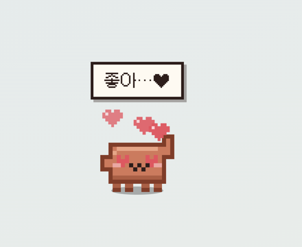
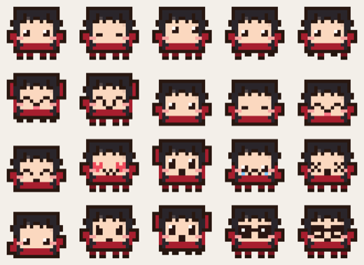

# claude-bouncer


🐾 바탕화면을 돌아다니는 작은 도트 클로드 — 같이 놀고, **어느 Claude Code 세션이 나를 부르는지** 확실하게 알려줘요. (macOS / Windows)
🐾 A tiny pixel Claude that lives on your desktop — plays with you, and tells you **exactly which Claude Code session needs you**.

**[🇰🇷 한국어](#한국어) · [🇺🇸 English](#english)**

<p align="center">
  
  
</p>

---

## 한국어

### 이게 뭐야?

여러 터미널에서 Claude Code를 돌려두고 다른 일 하다 보면 "어느 창이 끝났지?", "권한 요청 떠 있는 거 아냐?" 하게 되죠.
클로디(클로드 도트 펫)는 평소엔 화면 여기저기를 돌아다니며 놀다가, 세션이 **끝나거나 나를 기다리면** 커서 앞으로 달려와서
**어떤 프로젝트·브랜치에서, 무슨 요청이, 어느 터미널 탭에서** 끝났는지 카드로 보여줘요. 카드를 누르면 그 탭으로 바로 이동합니다.

### 알림 — 확실하게

| | |
|---|---|
| 🃏 **출처가 보이는 카드** | 종류(작업 완료 / 권한 요청 / 입력 대기) · 프로젝트 · 🌿 git 브랜치 · 내가 보낸 요청 · 결과 요약 · 걸린 시간 · 터미널 앱과 탭(tty, tmux pane) |
| 🎯 **원클릭 이동** | iTerm2·macOS 터미널은 **정확한 탭까지**, tmux는 pane까지, 그 외(VS Code, Cursor, Warp, Ghostty, JetBrains…)는 앱 활성화 |
| ❗ **답할 때까지 안 사라짐** | 권한/입력 요청은 처리할 때까지 남고, 클로디가 옆에서 콩콩 뛰며 기다려요. 그 세션에 다시 입력하면 자동으로 정리 |
| 🔴 **배지 · 메뉴바 카운트** | 머리 위 배지와 메뉴바에 미확인 수 표시 (응답 필요는 빨간색) |
| ⏳ **작업 중 표시** | 일하는 세션이 있으면 머리 옆에 `•••`, 클로디도 같이 타닥타닥 |
| 💤 **자리 비움 요약** | 자리 비운 사이 온 알림을 돌아오면 "알림 3개 왔어!"로 알려줌 |
| 🖥 **세션 패널** | 열려 있는 세션 전체 현황 (작업 중 / 응답 필요 / 끝남) |
| 🔕 **방해 금지** | 소리·이동 없이 배지로만. 원하면 시스템 알림도 같이 |

<p align="center"> </p>

### 같이 놀기



- **⌥⇧C (Windows: Alt+Shift+C)** — 어디서든 누르면 클로디가 **커서 바로 앞으로 뿅** 나타나요. 알림이 있으면 카드도 같이 펼침. 키는 설정에서 바꿀 수 있어요
- **쓰다듬기** — 클로디 위에서 마우스를 좌우로 문지르면 ♥
- **클릭** 반응 · **드래그해서 던지기**(세게 던지면 어지러워해요) · **더블클릭** 놀이 메뉴 · **우클릭** 메뉴
- **🍪 밥 주기** — 쿠키를 들고 원하는 곳에 클릭해서 떨어뜨리면 달려와서 냠냠
- **⚽ 공놀이** — 공을 클릭해서 차면 클로디가 쫓아가서 나한테 다시 차줘요
- **🎮 쿠키 받기** — 마우스로 클로디를 움직여 쿠키 받기, 🐛 버그는 피하기 (30초)
- **🏃 술래잡기** — 도망다니는 클로디를 클릭해서 잡기 (20초)
- **배고픔 · 재미 · 기운**이 시간에 따라 줄어서, 심심하면 먼저 와서 "놀아줘!" 하고, 졸리면 자요. 놀아줄수록 레벨 업

<p align="center"></p>

### ✨ 나만의 클로디 (사진 → 도트)


패널 🐾 펫 탭에서 사진을 넣으면 [Higgsfield](https://higgsfield.ai)가 **나를 닮은 도트 클로디**로 바꿔줘요. 머리 모양·머리색, 피부색, 옷 색을 입힌 두 가지 버전 중에 고르고 안경·볼터치를 켜고 끌 수 있어요. 만든 모습은 저장해두고 언제든 기본 클로디와 바꿔 입을 수 있어요.

생성된 그림을 그대로 쓰지 않고 앱이 **스프라이트 격자(18×16)에 다시 맞춰 찍기 때문에**, 걷기·표정·게임 같은 모든 동작이 그대로 돼요.

1. [console.higgsfield.ai](https://console.higgsfield.ai)에서 API 키(Key ID + Secret)를 발급하고 잔액을 충전해요 (웹 구독과 별도인 API 잔액)
2. 패널 → 🐾 펫 → 키 저장 (OS 키체인으로 암호화해서 저장)
3. 사진을 끌어다 놓거나 골라서 **닮은 클로디 만들기**

사진은 생성을 위해 Higgsfield 서버로 보내져요. 한 번 만들 때 이미지 2장 분량이 API 잔액에서 차감돼요. 모델은 기본 `marketing-studio/image`이고 설정 파일에서 `xai/grok-imagine-image-2.0` 또는 `alibaba/qwen-image-3/edit`로 바꿀 수 있어요.

<p align="center"></p>

### 설치 — macOS

```bash
brew install node            # Node.js 18+ 가 없다면
git clone https://github.com/ESeungJun/claude-bouncer.git
cd claude-bouncer
./start.command              # Finder에서 더블클릭해도 돼요
```

처음 실행 시 `npm install`과 Claude Code 훅 설치가 자동으로 진행돼요.

### 설치 — Windows

1. https://nodejs.org 에서 LTS 설치 ("Add to PATH" 체크), https://git-scm.com/download/win 에서 Git 설치
2. PowerShell:
   ```
   git clone https://github.com/ESeungJun/claude-bouncer.git
   cd claude-bouncer
   start.bat
   ```
SmartScreen 경고가 뜨면 "추가 정보 → 실행".

### 정식 앱으로 빌드

```bash
npm run dist:mac   # .app + DMG + zip
npm run dist:win   # NSIS 설치파일
npm run pack       # 빠른 테스트용 .app
```

결과물은 `dist/`에 생겨요. `.app`을 옮겨도 다음 실행 때 훅 경로가 자동으로 갱신돼요.

### 테스트

메뉴바(트레이) 아이콘 → **테스트 알림 → 작업 완료 / 권한 요청**, 또는 패널 ⚙ 설정 탭의 테스트 버튼.

### 동작 원리

1. 앱이 `~/.claude/settings.json`에 `Stop` · `Notification` · `UserPromptSubmit` · `SessionEnd` 훅을 등록 (기존 훅은 건드리지 않고 자기 것만 갱신)
2. 훅(`scripts/send-notify.js`)이 이벤트 JSON에 터미널 정보(앱 번들 ID, tty, tmux pane)를 붙여 `127.0.0.1:17891`로 POST — 실패해도 Claude 세션엔 영향 없음
3. 앱이 세션별 상태를 추적하고, 대화 기록(transcript)에서 마지막 요청/응답 요약을 읽어 카드를 만듦
4. 화면 전체를 덮는 투명 창 위에서 클로디가 움직이고, 클로디·카드·메뉴 위에서만 마우스를 받으며 나머지 클릭은 그대로 아래 앱으로 통과

보안: 서버는 localhost에서만 열리고 `application/json` 요청만 받으며 `Origin` 헤더가 있는 요청(브라우저)은 거절해요.

### 제거

```bash
npm run uninstall-hook   # 훅만 제거 (메뉴바 → Claude Code 훅 → 제거 도 가능)
```

### 문제 해결

- **클로디가 안 보여요** — 메뉴바 아이콘 → `펫 부르기` 또는 단축키. 방해 금지가 켜져 있는지 확인
- **알림이 안 와요** — `~/.claude/settings.json`에 `send-notify.js` 훅이 있는지, 메뉴바 → 테스트 알림이 되는지 확인
- **단축키가 안 먹어요** — 다른 앱이 쓰는 조합일 수 있어요. 패널 ⚙ 설정에서 다른 키로 바꾸면 충돌 여부를 바로 알려줘요
- **포트 17891 사용 중** — `lsof -i :17891` (Windows: `netstat -ano | findstr :17891`)

### 레퍼런스

만들면서 참고한 데스크톱 펫들:

- [Shimeji](https://en.wikipedia.org/wiki/Shimeji_(software)) — 화면 위를 걸어 다니고 창에 매달리는 데스크톱 마스코트의 원조
- [Desktop Goose](https://samperson.itch.io/desktop-goose) — 마우스를 낚아채는 장난꾸러기 펫, "펫이 먼저 말 걸기"의 레퍼런스
- [VPet-Simulator](https://store.steampowered.com/app/1920960/VPet/) / 다마고치 — 배고픔·기분 같은 돌보기 요소
- [Pets Therapy – Desktop Pets](https://www.hartware.de/?p=368207) · [Peekoo](https://www.producthunt.com/p/peekoo) · [Petnunu](https://www.producthunt.com/products/petnunu-desktop) — 최근 데스크톱 펫들의 행동 패턴
- [clawd-on-desk](https://github.com/rullerzhou-afk/clawd-on-desk) — Claude Code 상태를 보여주는 도트 펫. claude-bouncer는 여기서 더 나아가 **"같이 놀기"와 "알림 출처를 확실히"** 쪽에 집중했어요

캐릭터 컨셉 시트와 앱 아이콘은 [Higgsfield](https://higgsfield.ai)로 만들었고(`docs/concept/`), 실제 게임 속 스프라이트는 프레임이 정확히 맞도록 코드로 한 픽셀씩 찍었어요(`renderer/js/sprites.js`, `npm run sprites`로 시트 재생성). 폰트는 [Galmuri](https://github.com/quiple/galmuri) (OFL).

---

## English

### What is it?

Clawd's little cousin lives on your desktop. Most of the time it wanders around, naps and asks you to play. When any Claude Code session **finishes** or **needs you**, it runs up to your cursor with a card that says exactly **which project and branch, which prompt, and which terminal tab** — click it to jump straight there.

### Notifications

- **Cards with the source**: kind (done / permission / waiting for input), project, git branch, the prompt you sent, a summary of the reply, how long it took, terminal app + tab (tty / tmux pane)
- **Jump back in one click**: exact tab in iTerm2 and Terminal.app, tmux pane selection, app activation for VS Code, Cursor, Warp, Ghostty, JetBrains and more
- **Stays until handled**: permission/input cards stick around (the pet waits next to you, hopping) and clear themselves once you answer in that session
- Unread badge + menu-bar count, "working…" indicator, "while you were away" summary, live sessions panel, Do-Not-Disturb, optional system notifications

### Play

- **⌥⇧C / Alt+Shift+C** anywhere: the pet pops up right in front of your cursor (rebindable in Settings)
- Pet it (rub the mouse back and forth), click it, drag and **throw** it, double-click for the play menu, right-click for the context menu
- **Feed** (drop a cookie anywhere), **fetch** (kick the ball, it kicks it back), **Cookie Catch** (catch cookies, dodge bugs) and **Tag** mini games
- Hunger / fun / energy drift over time; it comes to you when bored or hungry, sleeps when tired, and levels up as you play

### Make it look like you

Drop a photo into the Pet tab and [Higgsfield](https://higgsfield.ai) repaints Claudy with your hair, skin tone and clothes. The app snaps the result back onto the sprite grid, so every pose, expression and game keeps working. Pick one of two variants, toggle glasses / blush, and switch looks any time. Needs a Higgsfield API key (Key ID + Secret from [console.higgsfield.ai](https://console.higgsfield.ai), stored encrypted with the OS keychain); each run uploads the photo to Higgsfield and costs two image generations from your API balance.

### Install

```bash
git clone https://github.com/ESeungJun/claude-bouncer.git
cd claude-bouncer
./start.command      # macOS (Windows: start.bat)
```

Requires Node.js 18+. The first run installs dependencies and the Claude Code hooks. Build a standalone app with `npm run dist:mac` / `npm run dist:win`.

Try it from the menu-bar icon → **테스트 알림 (Test notification)**.

### How it works

The app registers `Stop`, `Notification`, `UserPromptSubmit` and `SessionEnd` hooks in `~/.claude/settings.json` (only its own entries). The hook script adds terminal info (bundle id, tty, tmux pane) and POSTs to `127.0.0.1:17891`; it never blocks or fails a Claude turn. The app tracks every session, reads the last prompt/reply from the transcript, and draws the pet on a transparent full-screen overlay that only catches the mouse over the pet, cards and menus. The local server accepts JSON only and rejects requests that carry an `Origin` header.

Uninstall the hooks with `npm run uninstall-hook`.

### Development

```bash
npm start          # run from source
npm test           # unit tests (sessions, server, store, sprites)
npm run sprites    # regenerate docs/sprite-sheet.png from sprites.js
npm run template   # regenerate assets/skin-template.png (reference sent to Higgsfield)
node tools/skin-preview.js generated.png out.png   # pixelize a generated image into a pose sheet
```

### Credits

Inspired by Shimeji, Desktop Goose, VPet and Tamagotchi, and by [clawd-on-desk](https://github.com/rullerzhou-afk/clawd-on-desk). Concept art and app icon made with Higgsfield; in-app sprites are hand-placed pixels in code. Font: [Galmuri](https://github.com/quiple/galmuri) (SIL OFL 1.1).

MIT © ESeungjun
