<div align="center">

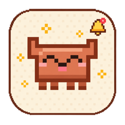

# Claude Bouncer

**A tiny pixel Claude that lives on your desktop.<br/>It plays with you, and tells you exactly which Claude Code session needs you.**

English · [한국어](README.ko.md)


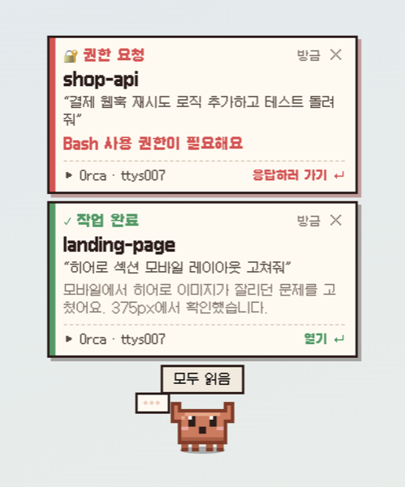
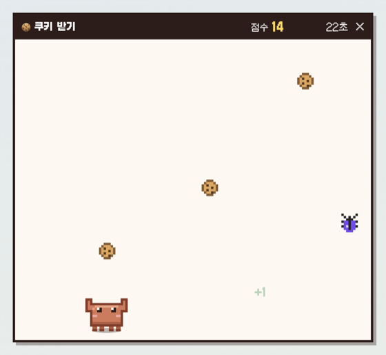

</div>

---

## Contents

- [Why](#why)
- [Features](#features)
- [Quick start](#quick-start)
- [Usage](#usage)
- [claude.ai in the browser](#claudeai-in-the-browser)
- [Make it look like you](#make-it-look-like-you)
- [How it works](#how-it-works)
- [Privacy & security](#privacy--security)
- [Troubleshooting](#troubleshooting)
- [Development](#development)
- [Credits](#credits)
- [License](#license)

## Why

When several Claude Code sessions run in different terminals, you keep switching back to check: *is it done? is it waiting for a permission?*
Claude Bouncer puts a small pixel pet on your desktop. Most of the time it wanders around, naps and asks you to play. When a session **finishes** or **needs you**, it runs up to your cursor with a card that says **which project, which branch, which prompt and which terminal tab** — one click takes you there.

> The app's interface is in Korean.

## Features

### 🔔 Notifications you can't miss

| | |
|---|---|
| **Cards that show the source** | Kind (done · permission · waiting for input), project, git branch, the prompt you sent, a summary of the reply, how long it took, terminal app and tab (tty / tmux pane) |
| **Jump back in one click** | Exact tab in iTerm2 and Terminal.app, tmux pane selection, app activation for VS Code, Cursor, Warp, Ghostty, JetBrains and more |
| **Stays until handled** | Permission and input requests stay up while the pet waits next to you; they clear themselves once you answer in that session |
| **At a glance** | Unread badge on the pet, count in the menu bar, a `•••` bubble while sessions are working |
| **While you were away** | Come back to "3 notifications while you were away!" |
| **Sessions panel** | Every open session: working · needs you · done |
| **claude.ai too** | With the browser extension, web chats on claude.ai notify you when Claude finishes answering |
| **Do Not Disturb** | Badge only, no sound or movement. Optional system notifications |

<p align="center">
  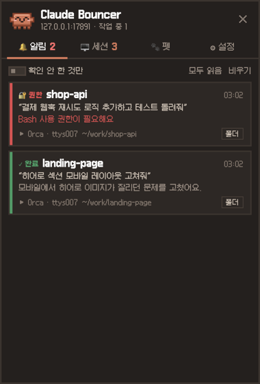
  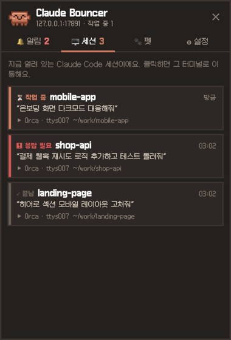
</p>

### 🐾 A pet to play with

- **Summon hotkey** — <kbd>⌥ Option</kbd>+<kbd>⇧ Shift</kbd>+<kbd>C</kbd> (Windows: <kbd>Alt</kbd>+<kbd>Shift</kbd>+<kbd>C</kbd>) from anywhere; the pet pops up in front of your cursor
- **Pet it, poke it, throw it** — rub the mouse over it for hearts, click to make it hop, drag and toss it (it gets dizzy if you throw too hard)
- **Feed** — a cookie sticks to your cursor; click anywhere to drop it
- **Fetch** — kick the ball and the pet kicks it back to you
- **Mini games** — 🍪 *Cookie Catch* (catch cookies, dodge bugs, 30 s) and 🏃 *Tag* (click the runaway pet, 20 s)
- **Needs and levels** — hunger, fun and energy drift over time; it comes over when bored or hungry, sleeps when tired, and levels up as you play

<p align="center">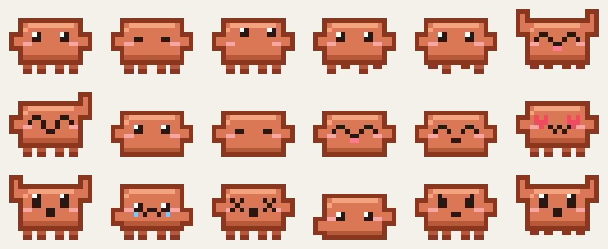</p>

### ✨ Make it look like you

Turn a photo into your own pixel character with [Higgsfield](https://higgsfield.ai) — see [below](#make-it-look-like-you).

## Quick start

**Requirements:** macOS or Windows 10/11 · [Node.js](https://nodejs.org) 18+ · [Claude Code](https://docs.anthropic.com/en/docs/claude-code)

```bash
git clone https://github.com/ESeungJun/claude-bouncer.git
cd claude-bouncer
./start.command          # macOS — or double-click it in Finder
start.bat                # Windows — or double-click it in Explorer
```

The first run installs dependencies and registers the Claude Code hooks. (The hooks are plain shell / PowerShell scripts, so Node.js isn't needed to receive notifications.) To check that everything works, open the menu-bar (tray) icon → **테스트 알림** (*Test notification*).

<details>
<summary><b>Build a standalone app</b></summary>

```bash
npm run dist:mac   # .app + DMG + zip
npm run dist:win   # NSIS installer
npm run pack       # quick unpacked .app for testing
```

Output goes to `dist/`. Moving the `.app` is fine — the hook path is refreshed on every launch. If Gatekeeper blocks the first launch, right-click → Open. On Windows, SmartScreen → More info → Run anyway.

</details>

## Usage

| Action | What happens |
|---|---|
| Click the pet | Hop and a little reaction (opens the cards if any are waiting) |
| Double-click | Play menu |
| Right-click | Context menu: feed, ball, games, sleep, panel, Do Not Disturb |
| Rub back and forth | Petting ♥ |
| Drag & release | Pick up and throw |
| Click a card | Jump to that terminal tab |
| <kbd>⌥</kbd><kbd>⇧</kbd><kbd>C</kbd> | Summon to your cursor (press again to close the cards) |
| Menu-bar icon | Panel, summon, play, Do Not Disturb, roaming, test notifications, hook management |

**Panel tabs:** 🔔 Inbox · 🖥 Sessions · 🐾 Pet (stats, actions, custom look) · ⚙ Settings (size, roaming, sound, system notifications, Do Not Disturb, launch at login, summon hotkey)

## claude.ai in the browser

Chats on claude.ai don't run Claude Code hooks, so a small browser extension (in [`extension/`](extension)) watches claude.ai tabs and tells the app when Claude **starts** and **finishes** answering. The card shows the conversation title, your question and the start of the answer; clicking it brings that exact tab back. If you were already looking at the tab when it finished, no card pops up.

Works in Chrome, Edge, Brave, Arc and other Chromium browsers:

1. ⚙ Settings → **claude.ai 웹 연결** → **설치 방법** (*How to install*) → **📁 확장 폴더 열기**. The app keeps a copy of the extension with its access token in its data folder; load that one.
2. Go to `chrome://extensions` (Edge: `edge://extensions`) and turn on **Developer mode**.
3. **Load unpacked** → pick the `extension` folder, then refresh your claude.ai tabs.

The settings row turns green ("연결됨") once the extension talks to the app. The extension only reads claude.ai pages and only talks to `127.0.0.1`.

## Make it look like you

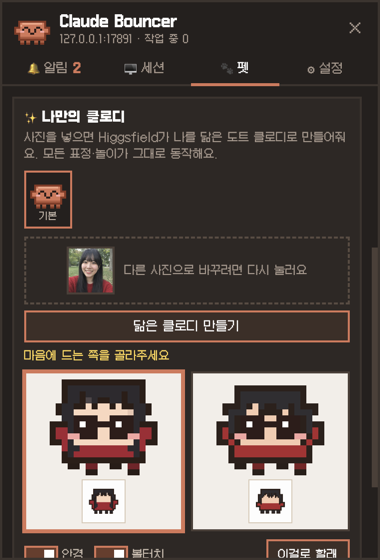

1. Open the panel → 🐾 **Pet** → **🔗 Higgsfield 계정으로 연결** (*Connect Higgsfield*) and sign in in your browser.
   It's the same MCP connector Claude Code uses for Higgsfield.
2. Drop in a photo (or click to pick one) and press **닮은 캐릭터 만들기** (*Make my character*). It takes 30–60 seconds.
3. Pick one of the two versions → **이걸로 할래** (*Use this one*). Saved looks can be swapped back any time.

**No Higgsfield account?** Pick one of the built-in looks — 🐱 cat, 🐶 puppy or 🍙 onigiri — or pick a photo and press **✉️ 직접 요청하기** (*Request one*): a compose window sends it (with your note and reply address) to the maintainer, who makes the character and replies by email.

<p align="center">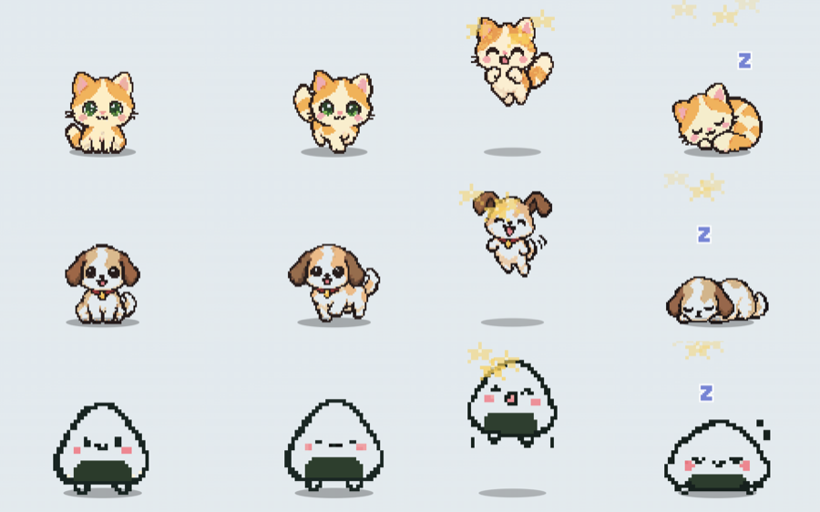</p>

**Two styles**

- **🎨 Pixel character** (default) — works with a photo of you, a pet, a plant, an object or a character you drew. It doesn't have to be human-shaped: a cat stays a four-legged cat, a cactus stays in its pot, and poses fit the body (paw steps, hops, wiggles, curling up to sleep). It becomes a cute chibi that stays recognizable: colors, silhouette, hairstyle (or ears, horns, tail, fur pattern), eyes, facial hair, accessories and clothing patterns are carried over, nothing is invented, and it never turns realistic. Higgsfield draws six poses (idle, blink, two walk frames, happy jump, asleep); the app cuts the sheet, detects the art's native pixel size and animates with those frames.
- **🟧 Claudy body** — keeps the classic body and paints your hair, skin tone and clothes on it, so every engine-drawn expression still works. Optional glasses and blush.

Each run makes two images (about 3 credits) from your Higgsfield account. Prefer an API key? Choose **API 키로 연결하기** and paste a Key ID + Secret from [console.higgsfield.ai](https://console.higgsfield.ai).

<p align="center">
  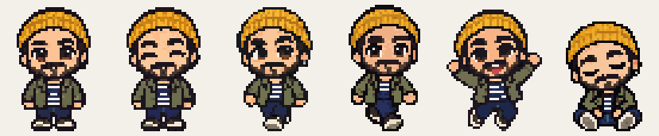<br/>
  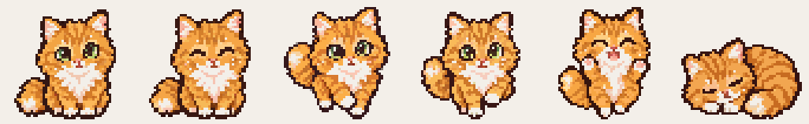<br/>
  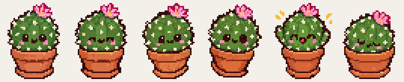
</p>

> Well-known copyrighted characters (for example from games or anime) are usually rejected by Higgsfield's content policy; no credits are charged.

## How it works

```
Claude Code ──hook──▶ send-notify.sh/.ps1 ──POST 127.0.0.1:17891──▶ Claude Bouncer ──▶ pet + cards
  Stop / Notification /         adds terminal app, tab tty,        tracks sessions, reads
  UserPromptSubmit / SessionEnd tmux pane                          the transcript summary
```

1. On launch the app registers four hooks in `~/.claude/settings.json` — `Stop`, `Notification`, `UserPromptSubmit`, `SessionEnd` — and only touches its own entries.
2. The hook script (`send-notify.sh` on macOS/Linux, `send-notify.ps1` on Windows — no Node.js needed) reads the event, adds where it came from (terminal bundle id, the tab's tty, tmux / Orca pane) and posts it to the app with a per-user token. It never blocks or fails a Claude turn.
3. The app tracks each session, reads the last prompt and reply from the transcript, and builds the card.
4. The pet lives on a transparent full-screen overlay that only catches the mouse over the pet, cards and menus; every other click goes straight through to your apps.

**What gets detected:**

| Where you use Claude | Detected? |
|---|---|
| Claude Code in a terminal, VS Code, Cursor, JetBrains (on this machine) | ✅ through hooks |
| claude.ai in Chrome · Edge · Brave · Arc | ✅ with the [browser extension](#claudeai-in-the-browser) |
| Claude desktop app chats | ❌ the app has no way to report this yet |
| Claude Code on the web (cloud sessions) | ❌ runs in the cloud, can't reach this computer |

## Privacy & security

- The local server listens on `127.0.0.1` only, checks the `Host` header, accepts JSON only and rejects web pages. Hook requests must carry a random per-user token (`~/.claude/claude-bouncer.token`, readable only by you), so other programs can't inject cards; the claude.ai extension can only report claude.ai chats.
- The packaged app ships with hardened Electron fuses (no `ELECTRON_RUN_AS_NODE`, no `NODE_OPTIONS`, no inspector flags, app code only from the signed-in asar) and blocks navigation and pop-ups in its windows.
- Clicking a card only ever opens real folders, never files or apps named in a notification.
- Prompts and transcript summaries stay on your machine (`~/Library/Application Support/claude-bouncer` on macOS).
- Higgsfield sign-in tokens and API keys are encrypted with the OS keychain (Electron `safeStorage`) and never stored in plain text; the API key is only ever sent to Higgsfield's API host.
- Only the custom look feature sends anything out: your photo goes to Higgsfield to generate the character, or — if you use *Request one* and tick the consent box — to the maintainer by email (via FormSubmit).

## Troubleshooting

<details>
<summary><b>I can't see the pet</b></summary>

Menu-bar icon → **펫 부르기** (*Summon*) or press the hotkey. Check that Do Not Disturb is off.
</details>

<details>
<summary><b>No notifications arrive</b></summary>

Check that `~/.claude/settings.json` has hooks that point to `send-notify.sh` (Windows: `send-notify.ps1`), then try menu-bar icon → **테스트 알림**. Menu-bar icon → **Claude Code 훅 → 다시 설치** re-registers the hooks.
</details>

<details>
<summary><b>The hotkey does nothing</b></summary>

Another app probably uses the same combination. Set a new one in ⚙ Settings → **부르기 단축키**; the panel tells you right away if it's taken.
</details>

<details>
<summary><b>Port 17891 is already in use</b></summary>

macOS: `lsof -i :17891` · Windows: `netstat -ano | findstr :17891` — stop the other process and restart.
</details>

<details>
<summary><b>Uninstall</b></summary>

`npm run uninstall-hook` (or menu-bar icon → **Claude Code 훅 → 제거**), then delete the folder or app.
</details>

## Development

```bash
npm start          # run from source
npm test           # unit tests: sessions, server, store, sprites, skins, Higgsfield clients
npm run sprites    # regenerate docs/sprite-sheet.png
npm run template   # regenerate assets/skin-template.png (reference sent to Higgsfield)
```

### Releasing

- `master` is for development; every change lands through a pull request.
- `release` is what ships. To release: bump `version` in `package.json` on master, then open a pull request **master → release** and merge it.
- Merging runs [`.github/workflows/release.yml`](.github/workflows/release.yml): tests → a **draft** GitHub release `v<version>` → macOS (Apple Silicon + Intel) and Windows installers attached. Check it, then press *Publish release*. A version that's already published is never overwritten.

```
main.js                 app lifecycle, overlay + panel windows, tray, IPC, hotkey
lib/
  sessions.js           session tracking, transcript summary, git branch, terminal names
  server.js             localhost hook receiver
  focus.js              jump to the right terminal tab
  higgsfield-mcp.js     Higgsfield over MCP (OAuth) for custom looks
  higgsfield.js         Higgsfield API-key client + prompts
  store.js              JSON persistence
extension/              claude.ai browser extension (MV3)
renderer/
  overlay.*, js/        the pet: sprites, behaviour, cards, games, sounds
  js/pixelize.js        generated image → pixel frames
  panel.*, maker.js     inbox, sessions, pet, settings, custom look
scripts/                hook scripts (send-notify.sh / .ps1) + installer
tools/                  sprite sheet / skin preview / PNG helpers
```

## Credits

- Inspired by [Shimeji](https://en.wikipedia.org/wiki/Shimeji_(software)), [Desktop Goose](https://samperson.itch.io/desktop-goose), [VPet](https://store.steampowered.com/app/1920960/VPet/) and Tamagotchi, and by [clawd-on-desk](https://github.com/rullerzhou-afk/clawd-on-desk), which shows Claude Code state as a pixel pet. Claude Bouncer focuses on playing together and making the source of every notification obvious.
- Concept sheet and app icon made with [Higgsfield](https://higgsfield.ai) (`docs/concept/`); the in-app sprites are hand-placed pixels in code (`renderer/js/sprites.js`).
- Font: [Galmuri](https://github.com/quiple/galmuri) (SIL Open Font License 1.1).

## License

[MIT](LICENSE) © ESeungjun
