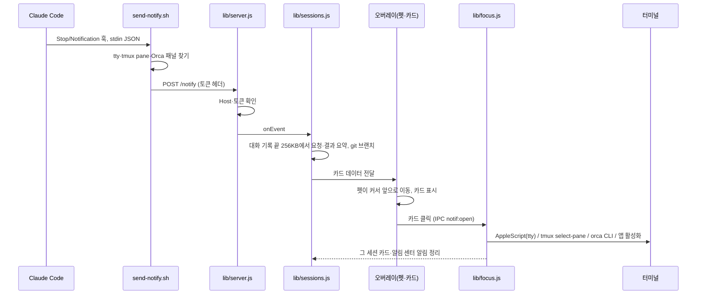
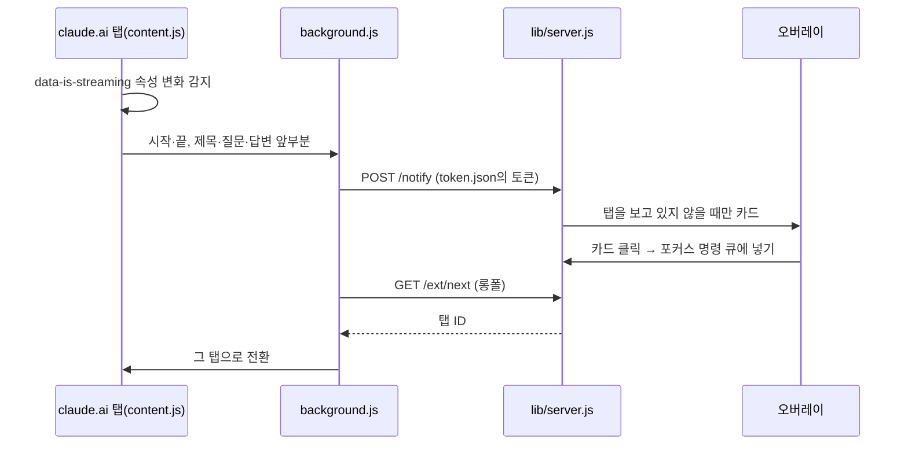
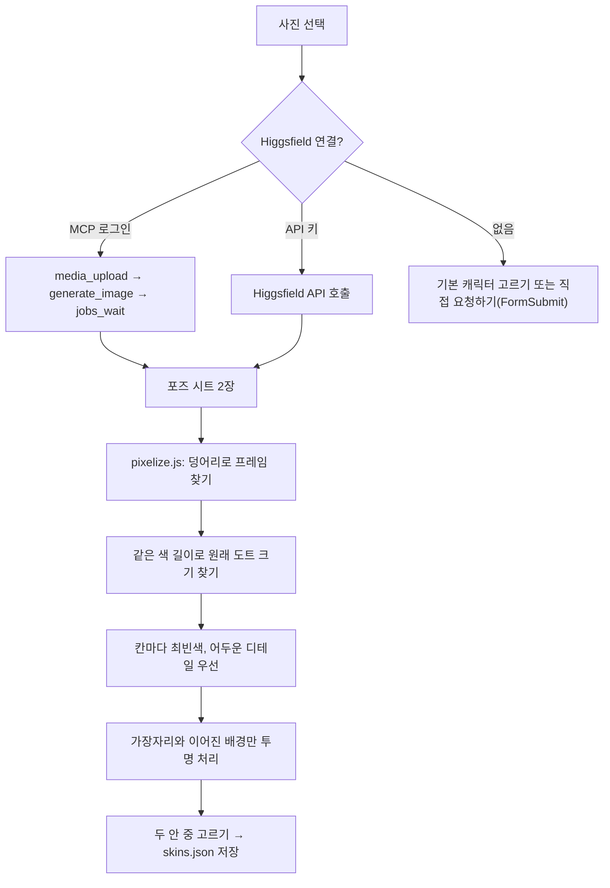
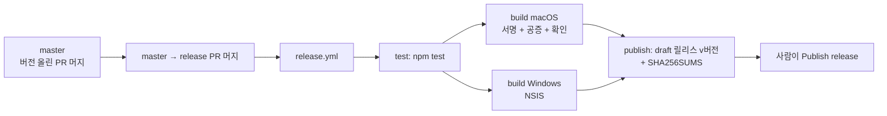

# Claude Bouncer 구현도

> 2026-11-05에 v0.3.7 코드에서 복원했다.

관련 문서: [기획서](기획서.md) · [설계서](설계서.md) · [결정기록](결정기록.md)

## 폴더·모듈 구조

```
claude-bouncer/
├─ main.js                 앱 생명주기, 오버레이·패널 창, 트레이, IPC, 단축키, 업데이트 설치
├─ preload.js              렌더러에 여는 IPC 채널
├─ lib/
│  ├─ server.js            로컬 수신 서버(127.0.0.1:17891), 토큰·Host 확인, 확장 롱폴 큐
│  ├─ sessions.js          세션 추적, 대화 기록 끝부분 요약, git 브랜치, 터미널 이름
│  ├─ focus.js             카드 → 터미널 탭 이동(AppleScript·tmux·Orca CLI), 앞에 있는 터미널 확인
│  ├─ update.js            최신 릴리스 확인, 다운로드·체크섬 대조, macOS 번들 교체 스크립트
│  ├─ higgsfield-mcp.js    Higgsfield MCP 연결(OAuth + PKCE, 로컬 콜백)
│  ├─ higgsfield.js        Higgsfield API 키 클라이언트, 캐릭터 시트 프롬프트
│  ├─ skins.js             기본 캐릭터(고양이·강아지·주먹밥) 불러오기, 스킨 검증
│  ├─ request.js           "직접 요청하기" 전송(FormSubmit), 입력 검증·1분 제한
│  ├─ actions.js           펫 놀이 메뉴 항목
│  └─ store.js             JSON 저장(기본값 병합, 지연·원자적 쓰기)
├─ renderer/
│  ├─ overlay.html/.css    투명 전체 화면 창
│  ├─ js/overlay.js        오버레이 진입점, 클릭 통과 판정
│  ├─ js/pet.js            펫 행동(돌아다니기·욕구·레벨·잠)
│  ├─ js/sprites.js        18×14 도트 스프라이트를 코드로 정의
│  ├─ js/notify.js         알림 카드
│  ├─ js/play.js           밥·축구·쿠키 받기·술래잡기
│  ├─ js/pixelize.js       생성된 시트 → 도트 프레임
│  ├─ js/sound.js          효과음
│  ├─ js/common.js         공용 함수
│  ├─ panel.html/.css/.js  알림함·세션·펫·설정 패널
│  ├─ maker.js             나만의 캐릭터 만들기 화면
│  └─ fonts/               Galmuri 폰트
├─ scripts/
│  ├─ install-hook.js      ~/.claude/settings.json에 훅 4개 등록·제거
│  ├─ send-notify.sh       macOS·Linux 훅
│  └─ send-notify.ps1      Windows 훅
├─ extension/              claude.ai 브라우저 확장(MV3: manifest·content·background)
├─ assets/                 트레이 아이콘, 기본 캐릭터(presets/*.json), 스킨 템플릿
├─ build/                  앱 아이콘, macOS 권한 파일(entitlements.mac.plist)
├─ tools/                  스프라이트 시트·스킨 미리보기·PNG 도구
├─ test/                   node:test 단위 테스트
├─ docs/                   README 이미지, 컨셉 시트(concept/), 이 문서들
└─ .github/workflows/release.yml   릴리스 빌드
```

핵심 파일 링크: [main.js](../main.js) · [lib/server.js](../lib/server.js) · [lib/sessions.js](../lib/sessions.js) · [lib/focus.js](../lib/focus.js) · [lib/update.js](../lib/update.js) · [renderer/js/pixelize.js](../renderer/js/pixelize.js) · [scripts/install-hook.js](../scripts/install-hook.js) · [release.yml](../.github/workflows/release.yml)

## 주요 흐름

### 1. 훅 이벤트 → 카드 → 탭 이동



### 2. claude.ai 웹 채팅



### 3. 사진 → 도트 캐릭터



### 4. 릴리스



## 빌드·실행·배포

```bash
npm install          # 처음 한 번
npm start            # 소스로 실행 (start.command / start.bat도 같은 일 + 훅 등록)
npm test             # node --test test/*.test.js
npm run install-hook # 훅 등록, --uninstall은 npm run uninstall-hook
npm run pack         # 빠른 테스트용 .app
npm run dist:mac     # dmg + zip
npm run dist:win     # NSIS 설치 파일
npm run sprites      # docs/sprite-sheet.png 다시 만들기
npm run template     # assets/skin-template.png 다시 만들기
```

- 개발 중 확인은 `--remote-debugging-port`로 띄워 CDP로 상태 조회·캡처한다(프로젝트 메모리). 사용자 화면을 가리지 않는다.
- 깃 흐름: `master`는 PR 필수. 기능 브랜치 → PR → 바로 머지(프로젝트 메모리).
- 릴리스: `master`에서 `package.json` 버전을 올리고 `master → release` PR을 머지 → 워크플로가 draft 릴리스 생성 → 확인 후 공개. 이미 공개된 버전은 덮어쓰지 않는다.
- 워크플로 수정은 커밋 전에 `actionlint`로 검사한다(프로젝트 메모리: SHA만 적은 액션 참조로 시작이 실패한 적이 있다).

## 버전·릴리스 현황

| 태그 | 날짜 | 주요 내용 |
|---|---|---|
| v0.3.0 | 2026-10-17 | v2 첫 공개: 도트 펫, 출처 카드, 나만의 캐릭터, claude.ai 확장, 설치 파일 |
| v0.3.1 | 2026-10-19 | 돌아다니기를 끄면 제자리에서 알리기, macOS 첫 실행 안내 |
| v0.3.2 | 2026-10-21 | 새 버전 알림, 입력 대기 알림 정리·터미널 전환 시 자동 정리 |
| v0.3.3 | 2026-10-21 | 앱 안 업데이트(체크섬 대조 후 교체) |
| v0.3.4 | 2026-10-21 | 셸 없이 뜬 Orca 세션도 탭 이동, 축구하기 |
| v0.3.5 | 2026-10-21 | 축구하기: 마우스로 공 차기 |
| v0.3.6 | 2026-10-22 | 집중 모드 |
| v0.3.7 | 2026-10-22 | macOS Developer ID 서명 + Apple 공증 |

태그는 `release` 브랜치의 머지 커밋에 붙어 있다. 내용은 `git log 이전태그..태그`로 확인했다.

v1(2026-04-22~04-27)은 태그 없이 master에만 있다.

## 앞으로 할 일

- Windows 코드 서명(워크플로 주석 "Windows is still unsigned").
- 그 밖에 계획으로 남은 항목은 기록이 없다.
