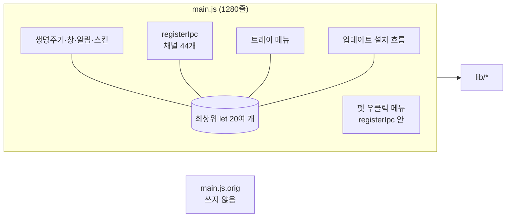
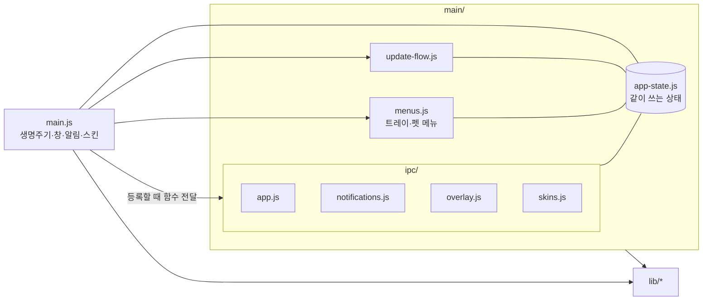

# main.js 나누기 (IPC 등록·업데이트 흐름·메뉴)

> 2026-11-17 · 이슈 [#75](https://github.com/ESeungJun/claude-bouncer/issues/75) · 작은 리팩토링이라 1·2·4·6절만 쓴다.

관련 문서: [구현도](../구현도.md) · [설계서](../설계서.md)

## 1. 왜 해야 하나

- `main.js`가 1280줄이다. 그중 `registerIpc` 한 함수가 약 200줄이고, 성격이 다른 IPC 채널 44개(스킨·설정·알림·오버레이)를 한꺼번에 등록한다. 스킨 채널 하나를 고칠 때도 이 함수 전체를 훑어야 한다.
- 업데이트 설치 흐름(확인 → 다운로드 → 번들 교체 → 재시작 뒤 결과 알림, 약 150줄)과 트레이 메뉴(약 90줄)도 같은 파일에 있다. 바뀌는 이유가 서로 다른 코드가 한 파일에 몰려 있다.
- 창·트레이·업데이트 상태를 담은 최상위 `let`이 20개가 넘는다. 어떤 값을 어느 함수가 쓰는지는 파일 전체를 검색해야 알 수 있다.
- 커밋 `b25b53c`에서 실수로 들어간 `main.js.orig`(1210줄)가 남아 있다. 어디서도 부르지 않고, 패키지 빌드 `files` 목록에도 없다.
- 안 하면: `main.js`는 기능이 붙을 때마다 계속 커지고, `main.js`에는 테스트가 없어서 고칠 때마다 영향 범위를 눈으로만 확인해야 한다.

## 2. 전·후 비교

| 항목 | 전 | 후 |
|---|---|---|
| `main.js` | 1280줄: 생명주기, 창, 알림, 스킨, 트레이, 업데이트, IPC 44개 | 생명주기, 창, 알림, 스킨, 단축키만 남김 |
| IPC 등록 | `registerIpc` 한 함수 | `main/ipc/` 영역별 4개 파일(앱·설정, 알림·세션, 오버레이, 스킨). `registerIpc`는 이 넷을 부르기만 함 |
| 업데이트 설치 흐름 | `main.js` 안 | `main/update-flow.js` (업데이트 상태 `update`는 이 파일 안에만 있음) |
| 트레이·펫 우클릭 메뉴 | `main.js` 안 두 곳에 같은 체크 항목 3개·종료 항목이 따로 있음 | `main/menus.js` 한 곳, 같은 항목은 한 함수로 만듦 |
| 여러 파일이 같이 쓰는 상태 | 최상위 `let` | `main/app-state.js` 객체 하나. 읽고 쓰는 곳은 모두 `state.x`로 바로 접근(복사본 없음) |
| 한 파일 안에서만 쓰는 상태 | 최상위 `let` | 그 파일 안의 `let` 그대로 |
| 의존 방향 | - | `main.js` → `main/*` → `lib/*`. `main/*`은 `main.js`를 `require`하지 않고, 필요한 함수는 등록할 때 인자로 받음 |
| 쓰지 않는 파일 | `main.js.orig` 1210줄 | 삭제 |
| 패키지 빌드 | `build.files`에 `main.js`, `lib/**` … | `main/**` 추가 |

### 전 설계도

### 후 설계도

## 4. 단계별 계획

단계마다 확인하는 것(하나라도 다르면 그 단계 커밋을 되돌린다):
- `npm test` (lib 단위 테스트 85개)
- `node --check`로 `main.js`와 `main/**/*.js` 문법 검사
- `ipcMain.handle/on` 채널 이름 목록을 정렬해 전과 `diff` → 같아야 함 (`main.js`에는 테스트가 없어 가장 큰 회귀 위험)
- 스모크 비교: `electron`을 모의 객체로 바꿔 `main.js`를 불러 `whenReady`를 돌린 뒤, IPC 핸들러 44개 전부와 트레이·펫 메뉴의 모든 항목, 훅 이벤트 하나를 실제로 불러서 반환값·메뉴 구조·다이얼로그 문구·저장된 `state.json`을 출력한다. 시간·ID를 고정한 출력이 전과 같아야 한다. (저장소 밖 `.work/`에서만 쓰고 커밋하지 않는다)

| 단계 | 하는 일 | 커밋 |
|---|---|---|
| 1 | `main.js.orig` 삭제. `package.json`·`release.yml`·코드에서 참조가 없는지 확인 | `chore:` |
| 2 | 여러 파일이 같이 쓰게 될 상태(`store`·`skinsStore`·`tracker`·`overlay`·`panel`·`hotkeyOk`·`hfCredits`·오버레이 영역·커서 추적)를 `main/app-state.js`로 옮기고 `main.js`의 읽기·쓰기를 모두 `state.x`로 바꿈. `build.files`에 `main/**` 추가 | `refactor:` |
| 3 | `registerIpc`를 `main/ipc/{app,notifications,overlay,skins}.js`로 나눔. 각 파일은 `register(ipcMain, deps)` 하나를 내보내고 필요한 함수만 `deps`로 받음 | `refactor:` |
| 4 | `updateState`~`startUpdateChecks`를 `main/update-flow.js`로 옮김 | `refactor:` |
| 5 | `trayIcon`·`updateTray`·`buildTrayMenu`·`createTray`와 펫 우클릭 메뉴를 `main/menus.js`로 옮김. 두 메뉴에 똑같이 있던 방해 금지·집중 모드·돌아다니기·종료 항목을 한 함수로 만듦(순서·문구·동작 그대로) | `refactor:` |
| 6 | `docs/구현도.md`의 폴더 구조를 바뀐 대로 고치고, 이 문서에 결과를 붙임 | `docs:` |

## 6. 리스크와 되돌리는 법

| 리스크 | 막는 법 |
|---|---|
| 채널 하나를 빠뜨리거나 이름을 잘못 옮김 → 렌더러 `invoke`가 "No handler" 에러 | 단계마다 채널 목록 `diff`, 스모크에서 중복 등록 검사 |
| 옮긴 함수가 옛 변수 이름을 참조 → 그 경로를 지날 때만 `ReferenceError` (문법 검사로는 못 잡음) | 스모크로 모든 핸들러·메뉴 항목 실행. 스모크가 못 지나는 경로(오버레이 크래시 재시작, 화면 변경 이벤트, 실제 업데이트 설치)는 옛 이름이 남았는지 `grep`으로 확인 |
| 창이 다시 만들어진 뒤 모듈이 옛 창 객체를 붙들고 있음 (오버레이는 크래시 때, 패널은 닫힌 지 5분 뒤 새로 만듦) | 창·스토어는 `app-state.js` 한 곳에만 두고 모듈은 쓸 때마다 `state.overlay`로 읽음. 값을 지역 변수나 `deps`로 복사해 넘기지 않음 |
| 패키지 빌드에 새 폴더가 빠짐 → 설치본이 켜지자마자 `Cannot find module` | 2단계에서 `build.files`에 `main/**` 추가. `npx electron-builder --dir`로 확인(가능하면) |
| 순환 `require` | `main/*`은 `main.js`를 `require`하지 않음. `menus.js` ↔ `update-flow.js`는 서로 `require`하지 않고 `main.js`가 함수를 넘김 |

되돌리기: 단계마다 커밋이 하나씩이라 문제가 생긴 단계만 `git revert`한다. 외부 계약(IPC 채널 이름·인자·반환값, 저장 파일 형식, `preload.js`)은 건드리지 않으므로 렌더러·저장 데이터는 되돌릴 것이 없다.

## 발견한 문제 (이번에 고치지 않음)

동작을 바꾸지 않는 리팩토링이라 아래는 적어 두기만 한다.

- `menu:pet` 핸들러가 `overlay.setAlwaysOnTop(true, 'floating')`을 부를 때 `overlay`가 없거나 없어졌는지 확인하지 않는다. 같은 핸들러의 `popup` 콜백은 확인한다. 오버레이가 막 크래시해 다시 만들어지는 1초 사이에 우클릭 메뉴 요청이 오면 예외가 날 수 있다(가능성 낮음).
- `display-metrics-changed` 처리도 `overlay`가 있는지만 보고 `isDestroyed()`는 보지 않는다(가능성 낮음).

## 결과 (2026-11-17)

| 항목 | 전 | 후 |
|---|---|---|
| `main.js` 줄 수 | 1280 | 862 |
| `registerIpc` | 200줄, 채널 44개 직접 등록 | 17줄, 영역별 등록 함수 4개 호출 |
| `main/` | 없음 | 7개 파일 586줄 (app-state 33 · ipc/app 61 · ipc/notifications 34 · ipc/overlay 45 · ipc/skins 99 · update-flow 180 · menus 134) |
| `main.js.orig` | 1210줄 | 삭제 |
| `main.js` 최상위 `let` 선언 줄 | 23줄 | 10줄 (공유 값은 `app-state.js`로, 업데이트 상태는 `update-flow.js`, 트레이는 `menus.js` 안으로) |

확인한 것 (단계마다 같은 방법, 전부 같음):
- `npm test` 85개 통과
- `node --check` `main.js`·`main/**/*.js` 통과
- IPC 채널 이름 44개(handle 39 · on 5) 정렬 목록이 전과 같음
- 스모크 비교 출력(약 360KB: 핸들러 반환값, 트레이·펫 메뉴 구조와 모든 항목 클릭, 다이얼로그 문구, 훅 이벤트 뒤 기록, 저장된 `state.json`)이 전과 바이트 단위로 같음
- 공유 이름이 `state.` 없이 남은 곳이 없는지 `grep` 검사
- `electron-builder --dir --mac --x64`(서명 없이)로 만든 `app.asar`에 `main/` 7개 파일이 모두 들어 있음

확인하지 못한 것:
- 실제 앱 실행. 켜면 `~/.claude/settings.json`의 훅 경로가 이 빌드로 바뀌고 이미 켜진 앱과 포트·단일 실행 잠금이 겹쳐서 띄우지 않았다. 스모크가 지나지 않는 경로(오버레이 크래시 재시작, 화면 추가·제거, 실제 업데이트 다운로드·교체, 패널 5분 뒤 정리)는 코드를 옮기기만 했고 `grep`으로만 확인했다.
- Windows 빌드.
- README의 폴더 구조 목록(`main.js … tray, IPC`)은 git-workflow 규칙(내부 리팩토링은 README를 건드리지 않음)에 따라 그대로 뒀다.
