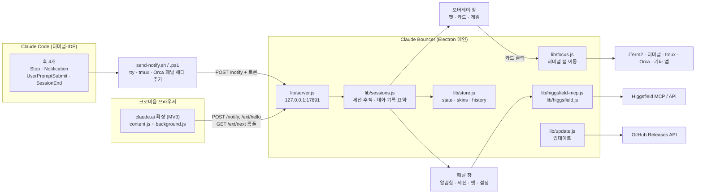

# Claude Bouncer 설계서

> 2026-11-05에 v0.3.7 코드와 git 히스토리에서 복원했다.

관련 문서: [기획서](기획서.md) · [구현도](구현도.md) · [결정기록](결정기록.md)

## 기술 스택과 고른 이유

| 영역 | 고른 것 | 이유 (근거) |
|---|---|---|
| 데스크톱 셸 | Electron 44 (`package.json` devDependencies) | 투명·클릭 통과 전체 화면 창, 트레이, 전역 단축키, OS 키체인(`safeStorage`)을 macOS·Windows 공통으로 쓸 수 있다. v1(2026-04)부터 Electron이었다. 2026-10-17 보안 리뷰에서 지원 종료된 Electron 32를 44.7로 올렸다(`73cd4fb`) |
| UI | 순수 HTML·CSS·JS + Canvas | 펫은 18×14 도트를 코드로 찍어 그린다(`renderer/js/sprites.js`). 프레임워크 없이 오버레이와 패널 두 창만 있다 |
| 훅 스크립트 | POSIX sh(`send-notify.sh`) / PowerShell(`send-notify.ps1`) | Node.js 없는 컴퓨터에서도 알림이 와야 한다. 처음엔 앱 바이너리를 `ELECTRON_RUN_AS_NODE=1`로 돌렸지만 보안 퓨즈를 켜려고 버렸다(`39ccf1c` → `73cd4fb`) |
| 앱 수신 | Node `http` 로컬 서버, `127.0.0.1:17891` | 훅·확장이 붙기 가장 단순한 경로 |
| 저장 | JSON 파일(`lib/store.js`) | 상태가 작다. 원자적 쓰기(`.tmp` → rename), 0600 권한, 깨진 파일은 옆에 보관 |
| 이미지 생성 | Higgsfield (MCP + OAuth, 대체로 API 키) | 사용자가 키 발급 단계에서 멈출 것 같아 계정 로그인 방식을 기본으로 했다(개발 글, `c82eeac`) |
| MCP 클라이언트 | `@modelcontextprotocol/sdk` | Claude Code의 Higgsfield 커넥터와 같은 연결 방식 |
| 패키징 | electron-builder 26 | dmg·zip·NSIS를 한 설정으로 만든다 |
| 배포 | GitHub Actions(`.github/workflows/release.yml`) + GitHub Releases | draft 릴리스로 확인 후 공개 |
| 폰트 | Galmuri(SIL OFL 1.1) | 도트 감성의 한글 폰트 |

후보를 나란히 비교한 기록(예: Tauri와 비교)은 남아 있지 않다. 그래서 비교표는 만들지 않았다.

## 전체 아키텍처

- 메인 프로세스(`main.js`)가 창 두 개(오버레이·패널), 트레이, 전역 단축키, IPC를 맡는다.
- 렌더러는 `preload.js`가 연 IPC 채널만 쓴다.
- 오버레이는 화면 전체를 덮는 투명 창이고, 펫·카드·메뉴 위에 있을 때만 마우스를 받는다(`mouse:ignore` IPC).

## 데이터 구조·저장소·외부 API

### 로컬 파일

| 파일 | 내용 | 위치 |
|---|---|---|
| `state.json` | 설정(크기·효과음·시스템 알림·방해 금지·집중 모드·돌아다니기·로그인 시 실행·단축키·스킨 모델), 펫 상태(배고픔·재미·기운·경험치·레벨·최고 점수 등), 업데이트 안내 기록 | 앱 데이터 폴더(`app.getPath('userData')`) |
| `skins.json` | 만든 모습 목록(최대 8개)과 현재 모습 | 앱 데이터 폴더 |
| `history-v2.json` | 알림 기록(최대 100개) | 앱 데이터 폴더 |
| `claude-bouncer.token` | 훅·확장 인증용 무작위 토큰(0600) | `~/.claude/` |
| `settings.json` | Claude Code 설정. 앱은 자기 훅 4개만 넣고 뺀다 | `~/.claude/` |
| 확장 사본 + `token.json` | 토큰을 넣은 확장 폴더 | 앱 데이터 폴더 |

macOS 앱 데이터 폴더는 `~/Library/Application Support/claude-bouncer`(README).

### 로컬 서버 경로 (`lib/server.js`)

| 경로 | 쓰는 쪽 | 설명 |
|---|---|---|
| `GET /health` | 누구나 | 살아 있는지 확인. 토큰 불필요 |
| `POST /notify` | 훅, 확장 | 이벤트 전달. 토큰 필요 |
| `POST /ext/hello` | 확장 | 확장 연결 알림 |
| `GET /ext/next` | 확장 | "이 탭으로 가" 명령 롱폴(대기자 최대 2) |

### 외부 API

| 대상 | 용도 | 언제 |
|---|---|---|
| Higgsfield MCP(OAuth, PKCE) / Higgsfield API(Key ID+Secret) | 사진 → 캐릭터 시트 생성 | 사용자가 캐릭터를 만들 때만 |
| FormSubmit | "직접 요청하기" 메일 전달 | 사용자가 동의하고 보낼 때만 |
| GitHub Releases API | 최신 버전 확인, 설치 파일·SHA256SUMS 다운로드 | 켠 뒤 15초, 이후 6시간마다 |

## 플랫폼별 차이

| 항목 | macOS | Windows |
|---|---|---|
| 훅 스크립트 | `send-notify.sh` (sh·ps·curl) | `send-notify.ps1` (PowerShell 5.1, UTF-8 입력) |
| 탭 이동 | iTerm2·터미널은 tty로 탭까지(AppleScript), tmux pane, Orca CLI로 탭, 그 밖은 번들 ID로 앱 활성화 | 앱을 앞으로 |
| 터미널로 직접 전환 시 카드 정리 | 지원(iTerm2·터미널은 탭 단위, 그 밖은 앱 단위) | 기록 없음 |
| 메뉴바/트레이 | 메뉴바(`LSUIElement`로 Dock 아이콘 없음) | 트레이 |
| 서명 | Developer ID 서명 + 공증(v0.3.7~), hardened runtime, apple-events 권한 | 서명 없음(SmartScreen 안내) |
| 앱 안 업데이트 | zip을 풀고 앱 종료 뒤 분리된 sh 스크립트가 번들 교체, 실패하면 복원 | NSIS 설치 파일을 조용히 실행 후 재시작 |
| 업데이트 불가 조건 | 소스 실행, 응용 프로그램 폴더 밖, 쓰기 권한 없음 → 다운로드 페이지 열기 | 소스 실행 등 → 다운로드 페이지 |

## 보안·권한

- 로컬 서버는 `127.0.0.1`에서만 열고 `Host` 헤더를 확인한다(DNS 리바인딩 대응). JSON 요청만 받고 웹 페이지 요청은 거절한다.
- 훅·확장 요청은 사용자별 토큰이 있어야 한다. 없으면 401. 훅이 `web` 출처를 사칭할 수 없고, 확장 요청은 claude.ai 필드로 줄인다.
- 세션 맵은 최대 300개, 롱폴 대기자는 최대 2개로 제한한다.
- 대화 기록은 `~/.claude` 아래 일반 파일만 읽는다(FIFO로 메인 스레드가 막히는 것 방지). 끝에서 256KB만 읽는다.
- Electron 퓨즈: `runAsNode`·`NODE_OPTIONS`·디버거 인자 끔, `onlyLoadAppFromAsar`·쿠키 암호화 켬.
- 앱 창 안에서 페이지 이동·팝업을 막는다.
- 카드에서 폴더를 열 때 실제 폴더만 연다. macOS 패키지 폴더(`.pkg`, `.workflow` 등)는 열지 않는다.
- Higgsfield 토큰·API 키는 `safeStorage`(OS 키체인)로 암호화해서만 저장한다. 암호화가 안 되면 저장을 거부한다. API 키는 Higgsfield API 주소로만 보낸다.
- OAuth 콜백은 정확한 `state`가 맞을 때만 받는다.
- 업데이트는 릴리스의 SHA256SUMS와 맞을 때만 설치한다. 링크는 응답이 아니라 검증한 버전 번호로 만든다.
- 릴리스 워크플로: 빌드 작업은 읽기 권한만, 설치 스크립트 없이(`npm ci --ignore-scripts`) 설치하고, 릴리스 쓰기는 별도 publish 작업만 한다. 서명 인증서·공증 키는 패키징 단계에만 넘긴다. 액션은 SHA로 고정한다.
- 바깥으로 나가는 데이터는 "나만의 캐릭터"(사진 → Higgsfield)와 "직접 요청하기"(동의 후 FormSubmit)뿐이다.

## 알려진 한계

- Claude 데스크톱 앱 채팅, 클라우드 Claude Code 세션은 감지하지 못한다.
- Windows는 탭 단위 이동이 없고 앱만 앞으로 온다. 코드 서명도 없다.
- claude.ai 감지는 답변 요소의 `data-is-streaming` 속성에 기대므로 claude.ai 화면 구조가 바뀌면 깨질 수 있다.
- 포트 17891을 다른 프로그램이 쓰면 알림을 못 받는다(README 문제 해결).
- 사진 캐릭터는 Higgsfield 크레딧을 쓴다(한 번에 이미지 2장, 약 3크레딧, README). API 키 경로는 실제 API로 검증한 기록이 없다(프로젝트 메모리).
- README 배지는 아직 "Electron 32"로 적혀 있다. 실제 의존성은 44.7이다.
